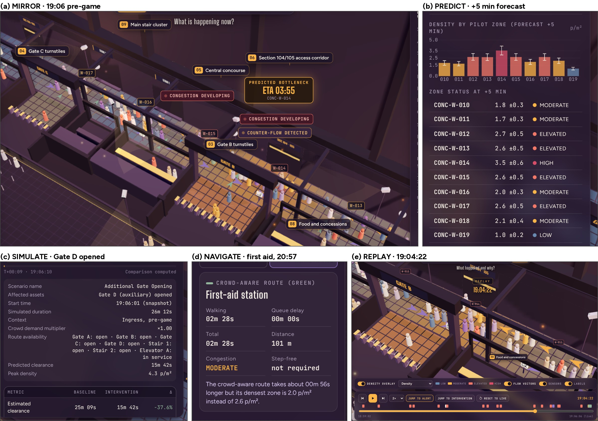
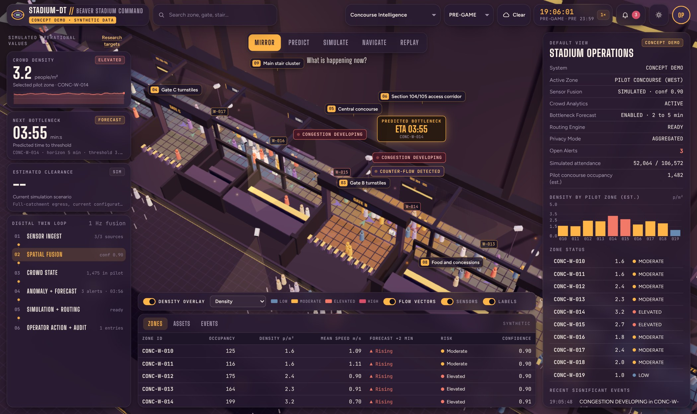
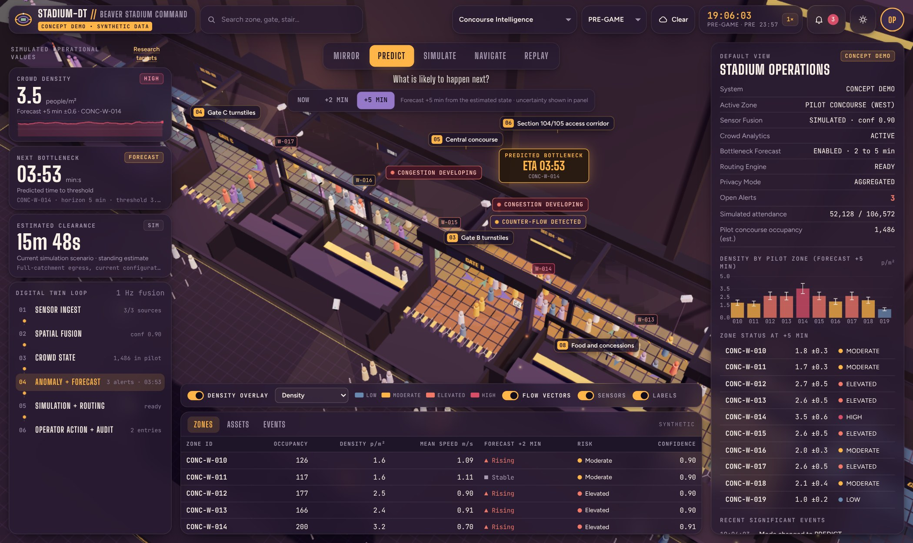
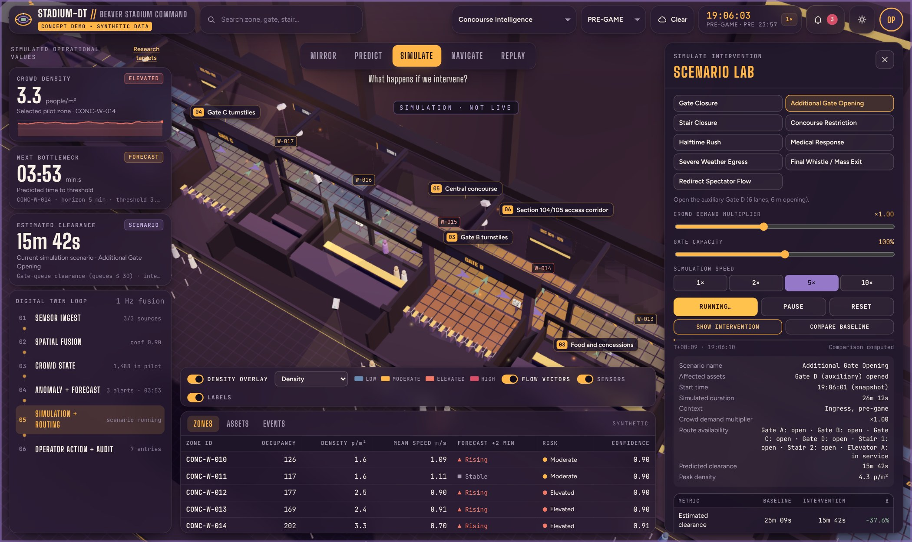
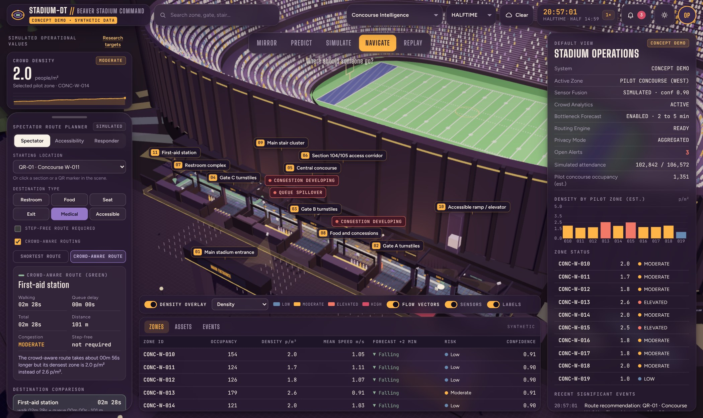
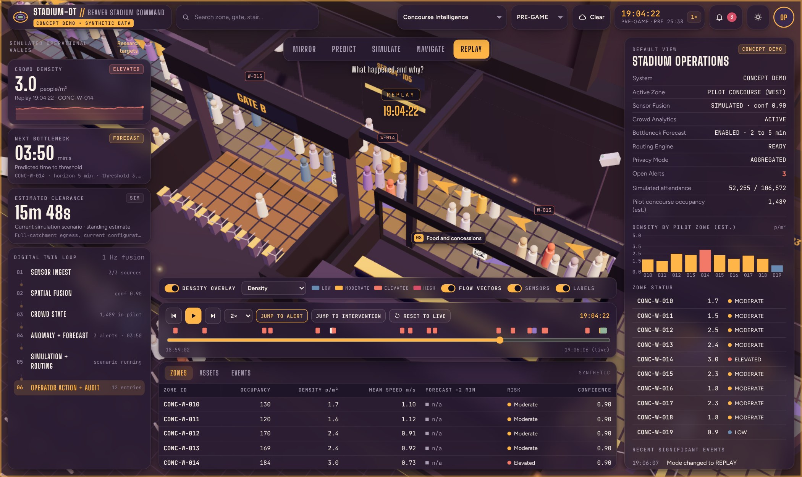
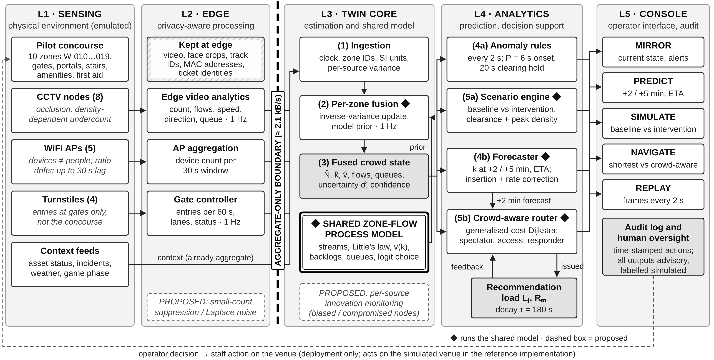

# STADIUM-DT · A privacy-aware crowd digital twin (concept demo)

STADIUM-DT is an interactive, browser-based digital twin of one concourse of a large American football stadium. It shows how a venue could **see** where crowds are, **predict** congestion a few minutes ahead, **simulate** interventions before trying them, and **guide** people along less crowded routes, using only aggregate sensor data (counts, flows, speeds, queue lengths) and never images or personal identifiers.

> **Concept demonstration, synthetic data only.** Nothing here is connected to Beaver Stadium or any real venue, camera, WiFi network, ticketing system or spectator. The 3D model is a stylised concept, gate and section labels are illustrative, and every number is produced by a simulation. Nothing in this repository is an emergency instruction or authorised routing guidance.



---

## Contents

- [Try it](#try-it)
- [The five modes](#the-five-modes)
- [How it works](#how-it-works)
- [Controls](#controls)
- [Repository structure](#repository-structure)
- [Dataset](#dataset)
- [Tests and tools](#tests-and-tools)
- [Learn with this project](#learn-with-this-project)
- [Limitations](#limitations)
- [Technical notes](#technical-notes)
- [Citation and credits](#citation-and-credits)

---

## Try it

**Quickest:** download or clone the repository and open `index.html` in a recent desktop browser (Chrome, Edge, Firefox or Safari). No build step and no installation are needed; three.js is included in `vendor/`.

**With a local server** (recommended, avoids browser file-access quirks):

```bash
git clone https://github.com/<your-user>/stadium-dt.git
cd stadium-dt
node tools/serve.js 8080        # or: python3 -m http.server 8080
# open http://localhost:8080/
```

**As a live demo on GitHub Pages:** in your repository go to **Settings → Pages**, choose **Deploy from a branch**, select `main` and `/ (root)`, and save. After a minute the demo is live at `https://<your-user>.github.io/stadium-dt/`.

The page needs WebGL. On first load it builds the stadium procedurally and starts a simulated game day at 19:06, shortly before kick-off.

---

## The five modes

Each mode answers one operator question. Switch with the buttons at the top or the keys **1–5**.

### 1 · MIRROR: *What is happening now?*



The 3D concourse is shaded by estimated crowd density (blue LOW, gold MODERATE, coral ELEVATED, red HIGH). Labels show open alerts such as *Congestion developing* or *Counter-flow detected*. The left column shows headline indicators and the six stages of the digital-twin loop; the right column and the table below list every zone's occupancy, density, walking speed, trend, risk and confidence.

### 2 · PREDICT: *What is likely to happen next?*



Choose a horizon of **now, +2 min or +5 min**. The twin rolls its crowd-flow model forward and shows the expected density per zone with an uncertainty band, plus the zone that will hit the bottleneck threshold (3.5 people/m²) first and how long until it does.

> The interactive forecast copies the simulator's internal state, so it is an *upper bound* on what a real twin could achieve. Realistic forecasters that only use sensor observations are discussed in the research paper.

### 3 · SIMULATE: *What happens if we intervene?*



The **Scenario Lab** takes a snapshot of the current state, runs a baseline and an intervention side by side in the same model, and compares clearance time, peak density, bottlenecks, throughput and route use. Nine scenarios are included:

| Scenario | What it changes |
| --- | --- |
| Gate Closure | closes Gate A, B or C; arrivals move to the open gates |
| Additional Gate Opening | opens the auxiliary Gate D (6 lanes) |
| Stair Closure | closes one stair from the upper seats |
| Concourse Restriction | narrows one zone (maintenance, temporary structure) |
| Halftime Rush | amenity surge; crowd-aware guidance and four extra windows |
| Medical Response | responder dispatch; reserved lane and service corridor |
| Severe Weather Egress | lightning protocol; Gate D, guidance, phased release |
| Final Whistle / Mass Exit | post-game egress; guidance and Gate D |
| Redirect Spectator Flow | raises the share of people following guidance |

The screenshot shows Gate D opening: queue clearance drops from 25 min 09 s to 15 min 42 s (−37.6%). The result table below it also shows that peak density rises, which is why a scenario should never be judged by clearance time alone.

### 4 · NAVIGATE: *Where should someone go?*



A route planner for **spectators**, **accessibility** (step-free) and **responders**. Pick a start point (or click a QR marker in the scene) and a destination type: restroom, food, seat, exit, medical or accessible route. The planner compares the shortest route with a crowd-aware route that weighs walking time, queues and current and forecast density. Every recommendation it issues is fed back into its own costs, so a burst of requests is spread across facilities instead of sending everyone to the same place. In the screenshot (halftime), the crowd-aware route to first aid takes about 56 s longer but its densest zone is 2.0 instead of 2.6 people/m².

### 5 · REPLAY: *What happened and why?*



Scrub back through recorded state frames (one every 2 s) with a timeline of alerts, predictions, simulations, routing changes and operator actions. *Jump to alert* and *Jump to intervention* move to the marked moments. The session starts with seven minutes of synthetic history so there is something to replay.

---

## How it works



The design has five layers ([detailed vertical version](docs/architecture-detailed.png)):

1. **Sensing (L1).** Cameras, WiFi access points, turnstiles and context feeds. In this demo they are *emulated*: each has a realistic weakness. Cameras undercount in dense crowds, WiFi counts devices rather than people and lags up to 30 s, and turnstiles only see the gates.
2. **Edge processing (L2).** Video and device data stay at the edge. Only aggregate messages (about 2.1 kB/s for ten zones) cross the **aggregate-only boundary**: per-zone counts, flows, speeds, queue lengths and per-gate entries. No images, no device IDs, no ticket identities.
3. **Twin core (L3).** Messages are fused once per second per zone using inverse-variance weighting with a model prior, which gives an occupancy estimate, its uncertainty and a confidence score. One **shared zone-flow model** (streams between gates, portals, stairs and amenities; Little's law; density-dependent walking speed; queues) drives everything else.
4. **Analytics (L4).** Anomaly rules every 2 s, a short-horizon forecaster every 5 s, the scenario engine, and the crowd-aware router with recommendation feedback. All four reuse the shared model.
5. **Console (L5).** The five modes, an audit log and replay. Every output is advisory and labelled as simulated.

The **digital-twin loop** panel in the app walks through the same pipeline: *Sensor ingest → Spatial fusion → Crowd state → Anomaly + forecast → Simulation + routing → Operator action + audit*. Click a stage to see what it does. In the *Sensor ingest* stage you can switch individual sensor sources off and watch the confidence drop.

---

## Controls

| Input | Action |
| --- | --- |
| `1` – `5` | MIRROR, PREDICT, SIMULATE, NAVIGATE, REPLAY |
| `/` | search for a zone, gate, stair, restroom or section |
| `D` / `F` | toggle density overlay / flow vectors |
| Arrow keys, `+` / `−` | pan and zoom (scene focused) |
| `Space` | play or pause replay and scenario playback |
| `P` / `,` `.` | pause the demo clock / slower or faster (1×, 2×, 5×, 10×) |
| `Esc` | clear selection, close dialogs |
| Mouse | left-drag pan, right-drag rotate, wheel zoom, double-click focus |
| Touch | one finger pan, two fingers pinch to zoom and rotate |

The top bar also lets you jump to a game phase (pre-game, 1st half, halftime, 2nd half, post-game), change the simulated weather, switch day/night lighting and open the alert list.

---

## Repository structure

```
stadium-dt/
├── index.html                 page markup (top bar, panels, dialogs) and script order
├── css/styles.css             all styles (dark operations-room theme, responsive layout)
├── js/                        application code, loaded in this order
│   ├── 01-core.js             palette, helpers, seeded random numbers, clock, shared state, event log
│   ├── 02-venue-schedule.js   concourse layout, gates, amenities, seating groups, game-day schedule
│   ├── 03-flow-model.js       aggregate crowd-flow model (class Model): streams, queues, Little's law
│   ├── 04-twin-sensing-fusion.js  synthetic sensors, fusion, anomaly rules, forecast (class Twin)
│   ├── 05-scenarios.js        what-if scenario definitions and the baseline/intervention runner
│   ├── 06-walk-graph-routing.js   walkable graph, Dijkstra, crowd-aware route planner with feedback
│   ├── 07-scene.js            procedural 3D stadium (three.js): bowl, concourse, gates, lights
│   ├── 08-agents.js           visible anonymous agents that sample the model's flows
│   ├── 09-view.js             per-frame drawing: heat tiles, flow arrows, labels, picking
│   ├── 10-interface.js        modes, top bar, KPI cards, detail panel, tables, search, dialogs
│   ├── 11-operations.js       Scenario Lab, route planner and replay recorder
│   └── 12-main.js             main loop and boot sequence
├── vendor/three/              three.js r147 and OrbitControls (MIT licence)
├── data/                      synthetic game-day dataset and paper result tables (see data/README.md)
├── docs/
│   ├── LEARNING_GUIDE.md      a step-by-step path for learning from this project
│   ├── architecture.svg/.png  architecture diagram (compact) and -detailed version
│   ├── dataset-descriptor.pdf paper describing the dataset
│   └── screenshots/           screenshots used in this README
├── tools/
│   ├── serve.js               zero-dependency local web server
│   ├── smoke-test.js          headless browser test of all five modes
│   ├── generate-dataset.js    regenerates the dataset from the demo's own model
│   └── three-stub.js          no-op three.js stand-in for headless data generation
└── package.json               npm scripts for the tools (the demo itself needs no npm)
```

The JavaScript files are plain scripts, not modules. They share top-level declarations, so the order in `index.html` matters: each file may use anything defined in the files before it.

---

## Dataset

`data/` contains a dataset produced by running this demo's own model through one game day. Full documentation is in [`data/README.md`](data/README.md) and [`docs/dataset-descriptor.pdf`](docs/dataset-descriptor.pdf).

| Part | Contents |
| --- | --- |
| `data/synthetic_game_day/` | 18:30–22:59 at one-minute resolution: `zones.csv` (2,700 rows, true vs estimated occupancy, density, speed, flows, confidence, input weights), `gates.csv` (1,080), `amenities.csv` (1,080), `events.csv` (191 alerts) |
| `data/paper_results/` | 11 CSV tables with the results reported in the STADIUM-DT research paper (experiments E1–E7 and their configurations) |

What happens on the simulated day: three crowd peaks of roughly 1,570 people (19:15, pre-game arrivals), 1,550 (20:59, halftime) and 1,180 (22:37, egress). Zone W-014 is the only zone to reach HIGH density, and concession queues overflow their 40-person space before kick-off and at halftime. The estimates run about 2% low overall and up to 8% low above 3.5 people/m², while the confidence score stays near 0.90. That is a deliberate demonstration of how a biased sensor can make a twin overconfident.

---

## Tests and tools

The demo itself needs nothing but a browser. The tools need [Node.js](https://nodejs.org/) 18 or later:

```bash
npm install                 # installs Playwright (used by the test and the generator)
npx playwright install chromium
npm start                   # serve the demo at http://localhost:8080/
npm test                    # headless smoke test: all five modes + one scenario (about 2 minutes)
npm run generate-data       # regenerate the dataset into data/generated/
```

---

## Learn with this project

[`docs/LEARNING_GUIDE.md`](docs/LEARNING_GUIDE.md) is a self-paced path in five stages:

1. **Explore the demo.** A guided tour of the five modes with things to try.
2. **Understand the concepts.** Digital twins, crowd density, Little's law, sensor fusion and uncertainty, forecasting, routing feedback, all with pointers to the exact code.
3. **Read the code.** A reading order through the twelve files, with the functions that matter most.
4. **Analyse the dataset.** Python exercises with ready-to-run snippets.
5. **Experiment.** Change parameters (gate lanes, camera undercount, walking speed) and observe the effect.

---

## Limitations

- **Synthetic only.** The layout, capacities, arrival profile, crowd behaviour and sensor errors are design assumptions, not measurements.
- **Model, not physics.** Crowds are modelled as aggregate flows between zones. Individual behaviour, crowd pressure and falls are not represented, and densities above about 5 people/m² are outside the model's range.
- **Upper-bound forecasts in the UI.** PREDICT and the scenario snapshots use the simulator's internal state.
- **Not validated.** None of the targets in the original proposal (latency, detection time, forecast horizon, clearance error, survey alignment) has been validated with real data.
- **Privacy by design, not by proof.** Only aggregate data crosses the boundary, but small counts can still identify individuals; the demo implements no differential privacy or count suppression.

---

## Technical notes

- **No build step.** Plain HTML, CSS and JavaScript; open `index.html` and it runs.
- **three.js r147** is vendored in `vendor/three/` (the last release that still ships `examples/js/controls/OrbitControls.js` as a plain script).
- **Fonts** (Big Shoulders Display, Figtree, JetBrains Mono) load from Google Fonts; offline, the page falls back to system fonts.
- **Determinism.** Visual and sensor randomness comes from a seeded generator (`mulberry32(20261026)` in `01-core.js`); the crowd model itself is deterministic.
- **Performance.** The twin core is cheap: one simulation step takes well under a millisecond. Most of the frame time goes to rendering, so the demo prefers a machine with hardware-accelerated WebGL.

---

## Citation and credits

The design and its simulation-based evaluation are described in:

> D. Singh, "STADIUM-DT: A Privacy-Aware Digital Twin Framework for Predictive Crowd Management with Simulation-Based Failure-Mode Evaluation," manuscript, The Pennsylvania State University, 2026.

- 3D rendering: [three.js](https://threejs.org/) r147 (MIT licence, see `vendor/three/LICENSE`).
- Fonts: Big Shoulders Display, Figtree and JetBrains Mono via Google Fonts (SIL Open Font Licence).

**Licence:** the author has not yet chosen a licence for the STADIUM-DT code and data. Until a `LICENSE` file is added, all rights are reserved by the author.
